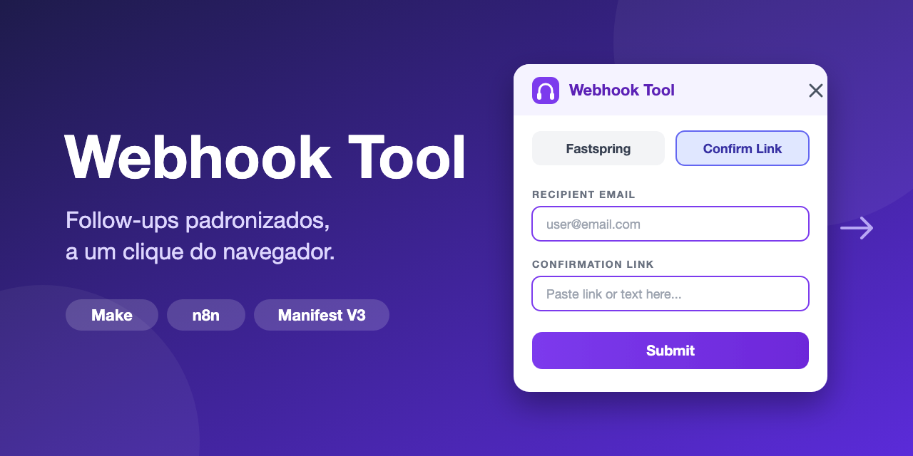

# Webhook Tool



Extensão para Chrome (**Manifest V3**) que transforma alguns cliques em chamadas de webhook estruturadas. Conecte-a a um cenário do **Make** ou do **n8n** e sua equipe dispara e-mails padronizados e follow-ups de clientes direto do navegador, sem copiar e colar entre sistemas.

## Por que existe

Follow-ups são repetitivos e é fácil errar quando escritos à mão. Com esta ferramenta, o atendente preenche um formulário curto, escolhe um motivo na lista e envia. A automação por trás do webhook faz o resto: monta o e-mail a partir do seu template, roteia e registra. Toda mensagem sai consistente e dentro do padrão da empresa.

## Funcionalidades

- **Formulários prontos:** link de confirmação, pedidos de cobrança/provedor de pagamento e ações de conta. Cada um envia um JSON limpo, com `reason_code` estável e um `reason` em inglês para facilitar o roteamento na automação.
- **Painel flutuante que não fecha sozinho:** ao clicar no ícone, o painel surge junto à barra de extensões com um efeito "gênio" (estilo macOS) e permanece aberto mesmo clicando fora, ideal para copiar valores de uma tela e colar no formulário. Fecha pelo **X** ou clicando no ícone de novo.
- **Histórico da sessão:** lista os envios bem-sucedidos, com opções de reenviar e limpar.
- **Cadastro de agentes:** nomes salvos localmente no navegador e escolhidos por menu.
- **Interface bilíngue:** Português (BR) e Inglês, com troca pelo cabeçalho.
- **Envio resiliente:** timeout configurável e mensagens de erro claras quando o webhook falha.

## Como funciona

```
Atendente preenche o formulário -> extensão envia JSON (POST) -> webhook Make / n8n -> template de e-mail -> destinatário
```

O service worker escolhe o webhook de destino pelo `type` do payload e faz um `POST` com corpo JSON.

## Instalação (modo desenvolvedor)

1. Defina as URLs dos seus webhooks em `config.js` (troque os `YOUR-WEBHOOK-ID`).
2. Abra `chrome://extensions` e ative o **Modo do desenvolvedor**.
3. Clique em **Carregar sem compactação** e selecione esta pasta.
4. Se o seu webhook não estiver em `hook.us1.make.com`, adicione o host em `host_permissions` no `manifest.json`.

## Configuração

Tudo fica em `config.js`:

- `WEBHOOK_CONFIRMATION_URL`, `WEBHOOK_FASTSPRING_URL`, `WEBHOOK_ACCOUNTS_URL`
- `REQUEST_TIMEOUT_MS`, `MAX_LOG_ENTRIES`, `VERSION`
- `*_REASON_EN`: rótulos em inglês enviados no campo `reason`, independentes do idioma da interface

## Estrutura do projeto

| Caminho | Função |
|---------|--------|
| `manifest.json` | Manifest MV3, permissões, service worker |
| `popup.html` / `popup.css` / `popup.js` | Interface, formulários, histórico, i18n em tempo de execução |
| `i18n.js` | Textos da interface (PT / EN) |
| `background.js` | Abre o painel flutuante e envia o `POST` JSON ao webhook correto |
| `config.js` | URLs dos webhooks, timeouts e rótulos |

## Privacidade

A extensão envia os dados digitados (e-mails, links, observações, nome do agente) apenas para as URLs de webhook que você configurar. Nada é enviado a outro lugar, e as preferências ficam salvas localmente no navegador.
